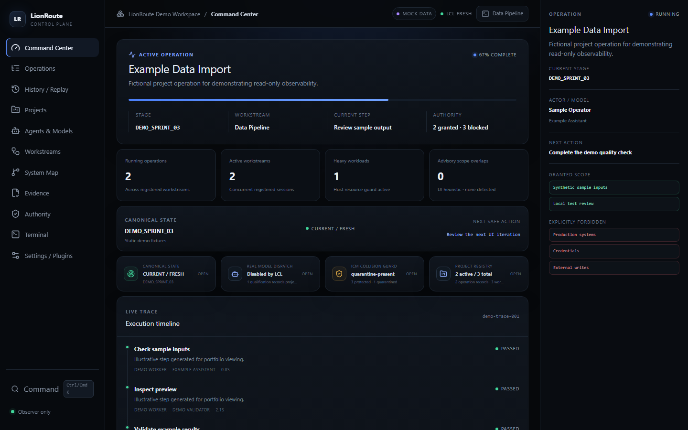
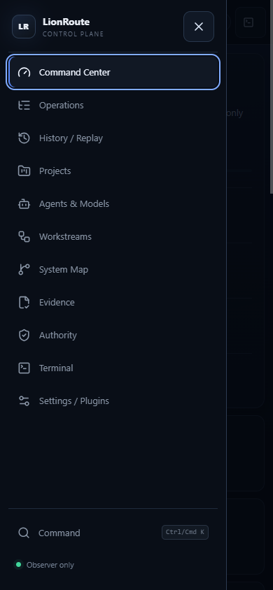
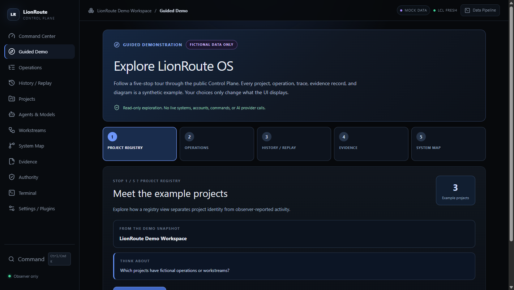

# LionRoute OS — Public Control Plane Demo

This portfolio project demonstrates an **observer-only operations dashboard** using React, TypeScript, Vite, and entirely fictional data. Real, reviewed engineering code is open-source; no private LionRoute runtime data or credentials are shipped.

**Current version: v0.2.0 ? Responsive Command Center.** All sample project names, events, timestamps, evidence, model assignments and policy records are synthetic. The demo does not operate the real LionRoute OS.

## Public preview (entirely fictional sample data)

*Screenshot generated from the local mock-only browser build. All displayed activity, evidence and project information are fictional and not production telemetry.*

## Responsive navigation (v0.2.0)

The reviewed v0.2.0 update introduces a responsive Command Center on tablets and phones and an accessible compact navigation drawer. The drawer provides active-page announcements, keyboard focus wrapping, Escape-to-close, focus restoration, and scroll locking while open. The desktop navigation remains available at wider screen sizes.

*Generated from a 390-pixel Chrome viewport using the synthetic-only demo, included in the v0.2.0 release.* See [responsive acceptance notes](docs/RESPONSIVE_ACCEPTANCE.md).

## Guided Demo (v0.3 development preview)

A new five-stop interactive walkthrough helps visitors explore the **fictional** project registry, operations and nested traces, observer-derived history, example evidence, and the logical system map. Visitors can open each existing view, return to the same walkthrough stop, jump between stops, or finish the guide.

*Original screenshot from a local read-only synthetic-data preview. This feature is in a development branch and is not part of the tagged v0.2.0 release.* See [Guided Demo acceptance](docs/GUIDED_DEMO_ACCEPTANCE.md).

## Features
Command Center; Operations with nested traces; History / Replay; Projects; Agents & Models; Workstreams; System Map; Evidence; Authority; and read-only Terminal. Filtering, keyboard navigation and drill-down are presentation behavior, not system actions.

## Local setup
Requires Node.js 24+ and npm 11+. All displayed records are synthetic; no accounts or private API keys are needed.

    npm ci
    npm run check:source
    npm run typecheck
    npm test
    npm run build
    npm run dev

Then open http://127.0.0.1:4317 in a browser. No credentials, services, API keys or backend are required.

## Trust boundary
The app is hard-locked to local synthetic telemetry even if gateway environment variables are supplied. The Terminal view is a structured event viewer, NOT a shell. There is no authority to execute commands, call model providers, change policies, spend money, or publish anything. Demo badges and evidence are examples, not verified production results.

See docs/ARCHITECTURE.md, docs/RESPONSIVE_ACCEPTANCE.md, docs/RELEASE_V0.2.0.md, docs/DUAL_TRACK_UPDATES.md, docs/LICENSING_DECISION.md, ROADMAP.md, SECURITY.md, and CHANGELOG.md.

## Learning in public
This public repository shows reviewed iterations through Git commits, passing CI, release notes, a roadmap, and independent update history. The private workspace is never mirrored automatically. A read-only update planner compares a small approved subset of committed private source files and flags them for manual sanitization; it cannot push, merge, grant publication authority, or import private history.

## License
The public Control Plane project is licensed under **Apache License 2.0** (see [LICENSE](LICENSE)). Dependencies retain their own licenses, documented in [THIRD_PARTY_LICENSES.md](THIRD_PARTY_LICENSES.md). The separate private LionRoute workspace is not part of this license grant.
